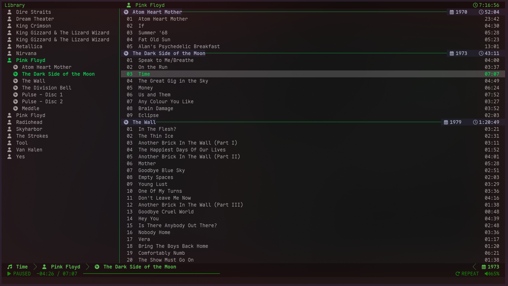

# My CMUS Config

## Preview



## Keybindings

Custom bindings are defined in [bindings.conf](bindings.conf). Standalone
uppercase letters mean **Shift + letter**: for example, `W` means **Shift+w**.

### Playback

| Key | Action |
| --- | --- |
| `Space` | Pause or resume playback |
| `Enter` | Activate the selected item; play the selected track |
| `Ctrl+N` | Next track |
| `Ctrl+P` | Previous track |
| `X` | Stop playback |
| `q` | Quit cmus |

### Volume

| Key | Action |
| --- | --- |
| `u` or `+` | Increase volume by 5% |
| `d` or `-` | Decrease volume by 5% |
| `m` | Mute or unmute |

### Navigation and seeking

| Key | Action |
| --- | --- |
| `j` | Move down |
| `k` | Move up |
| `h` | Seek backward 5 seconds |
| `l` | Seek forward 5 seconds |
| `w` | Switch between the artist/album pane and song pane in library view; switch panes in playlist view |
| `J` or `Tab` | Next view, cycling through views 1–7 |
| `K` or `Shift+Tab` | Previous view, cycling through views 1–7 |

`Shift+Tab` is named `back_tab` in the binding file. View cycling wraps at either end.

### Search

| Key | Action |
| --- | --- |
| `f` | Start a search |
| `n` | Next search match |
| `N` | Previous search match |

### Playback modes

| Key | Action |
| --- | --- |
| `s` | Cycle shuffle modes: off, tracks, and albums; album shuffle applies to library playback |
| `r` | Toggle repeat |
| `R` | Toggle repeating the current track |
| `F` | Toggle following the playing track in the list |

### Queue, selection, and metadata

| Key | Action |
| --- | --- |
| `e` | Add the selected tracks to the playback queue |
| `W` | Expand/collapse an artist's album list in library view; mark/unmark tracks in track-list views |
| `U` | Refresh cached music metadata |

To browse an artist's albums in library view, select the artist, press `W` to
expand, select an album, then press `w` to move into its song pane. Press `w`
again to return to the artist/album pane.

## Notifications

Desktop notifications use [0x61nas/cmus-notify](https://github.com/0x61nas/cmus-notify),
a Rust daemon that reports track and playback-status changes.

Install it with Cargo:

```sh
cargo install cmus-notify
```

The [rc](rc) starts one instance automatically when cmus opens, using the Cargo
binary at `~/.cargo/bin/cmus-notify`. Its startup options are:

| Option | Purpose |
| --- | --- |
| `--link` | Exit the notification daemon when cmus exits |
| `--cover` | Include album artwork when available |
| `--timeout 3` | Set the track-notification timeout to three seconds |
| `--cmus-remote-bin` | Read status through [notify-remote.sh](notify-remote.sh) |

The helper keeps stopped-state queries and unavailable mixer volumes compatible
with cmus-notify 0.1.0. Keep it executable.

Notification text and other preferences are configured separately in
`~/.config/cmus-notify/config.toml`. Use real newline escapes (`\n`) for line
breaks and supported markup such as `<b>Album:</b>` for bold labels.
